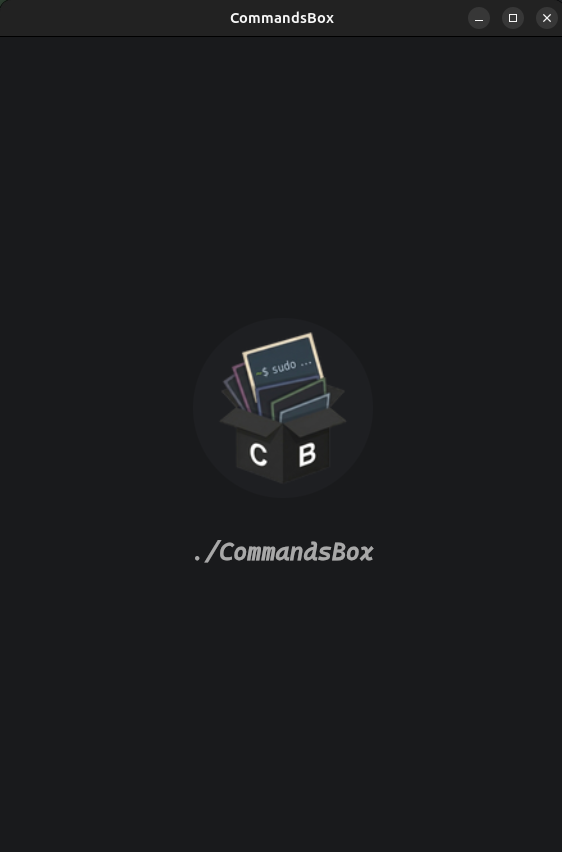
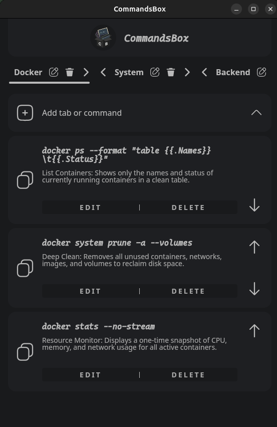

# CommandsBox

**CommandsBox** is an open-source CLI command manager. A lightweight and simple utility for developers who prefer a minimalist approach over bloated tools, providing a dedicated space to store and organize frequently used commands.

<p align="center">
  
  
</p>

## 🧪 About this project

This repository is a personal test project: a place for the author's own
thoughts and experiments in cross-platform development. It is a playground for
trying out architecture, shared UI, and platform integration approaches with
Kotlin Multiplatform, so its shape can change as those experiments evolve. It is
not a product roadmap and makes no stability promises.

Because of that, some modules and targets are intentionally more complete than
others. The iOS support described below is a working Simulator path, not a
commitment to ship on the App Store.

## ✨ Key Features

* **Kotlin Multiplatform:** Built from the ground up using **KMP**.
* **Shared UI:** Almost 100% shared UI code across all platforms with minimal platform-specific adjustments.
* **Multi-Platform Support:** Grouped by platform family — **Mobile** (Android and iOS Simulator) via `:app-android` and `:app-ios`, and **Desktop** (Windows and Linux) via `:app-desktop`.
* **Localization:** Supports 10 languages (English, German, French, Spanish, Indonesian, Hindi, Japanese, Korean, Brazilian Portuguese, and Russian) using **JetBrains Compose resources**.
* **Cross-Platform Database:** **Room** implementation that works on Android, Desktop, and the iOS Simulator.

## 📦 Modules

| Module | Responsibility |
| --- | --- |
| `:app-android` | Android application entry point. |
| `:app-desktop` | Desktop (JVM) application entry point and native packaging. |
| `:app-ios` | iOS entry point, Compose framework, and the Xcode host project. |
| `:common-ui` | Shared Compose UI, navigation, ViewModels, and UI dependency injection. |
| `:data` | Repositories and Room persistence, with platform-specific database setup. |
| `:common-resources` | Shared Compose resources and localized strings. |
| `:multi-mvi` | Shared MVI state, events, actions, and collection helpers. |

## ✅ Requirements

* **JDK 21** — the Gradle modules use `jvmToolchain(21)`.
* **Android SDK** matching `compileSdk` / `targetSdk` from `gradle/libs.versions.toml`.
* **macOS with Xcode** for the iOS target. The native host project lives in `app-ios/iosApp/`.

## 🚀 Running the app

**Android**

```sh
./gradlew :app-android:assembleDebug
```

This produces `app-android/build/outputs/apk/debug/app-android-debug.apk`, which
can be installed with Android Studio or `adb install` on a device or emulator.

**Desktop**

```sh
./gradlew :app-desktop:run
```

**iOS (Apple Silicon Simulator)**

1. Open `app-ios/iosApp/iosApp.xcodeproj` in Xcode.
2. Select the `iosApp` scheme and an Apple Silicon iPhone Simulator.
3. Press **Run**.

The Xcode "Run Script" build phase builds the shared `ComposeApp` framework
through Gradle, so no separate Gradle step is needed. See
[`app-ios/README.md`](app-ios/README.md) for requirements, verification details,
and known limitations.

## 🍎 iOS status

* Target: `iosSimulatorArm64` only (Apple Silicon Simulator, deployment target
  iOS 15.0). `iosX64` is not configured.
* The app reuses the shared Compose UI, navigation, ViewModels, MVI, repository,
  and Room schema; there is no separate SwiftUI implementation.
* Platform implementations provided for iOS: Room database in the app sandbox,
  clipboard access, and Koin wiring.
* Not configured: physical iPhone, release builds, and distribution signing /
  provisioning.

## 🛠 Maintenance & Build

The project includes a `linux-release.sh` script in the root directory. This script:
1. Automates the `.deb` package creation.
2. Patches the desktop shortcut file.
3. Correctly initializes `StartupWMClass` for proper Linux dock integration.

## 📚 Documentation

* `docs/architecture/` — engineering guidance, including the MVI conventions.
* `docs/product/specs/` — approved product and platform specifications.

---
*Developed by [MagicTools](https://magictools-apps.com)*
